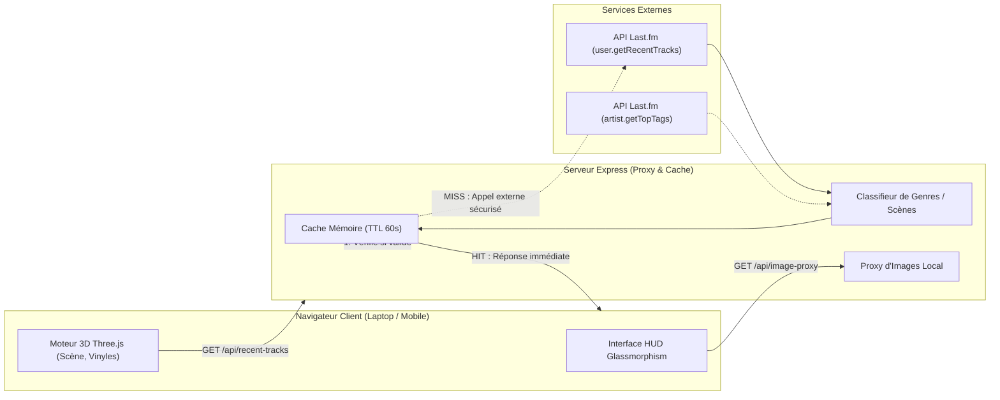

# 🎪 SOUNDLAND 3D — Ce à quoi ressemble ma musique

> Projet WebTech — Visualisation 3D interactive des écoutes musicales récentes Last.fm sous forme d'un festival immersif.

## 🎬 Démo vidéo

https://github.com/user-attachments/assets/2ea99f77-5b56-4b4d-9490-cf00170a222a

<video src="https://github.com/paul-des-brosses/API_Music/raw/main/Video_demo.mp4" controls width="100%"></video>

> 👉 [Voir / télécharger la vidéo de démo (`Video_demo.mp4`)](./Video_demo.mp4)

---

## 🌟 Le Concept : L'Archipel Musical / Festival des Genres

Plutôt qu'une simple liste plate d'albums, **Soundland 3D** transforme les dernières écoutes musicales en un festival en 3D composé de différentes scènes thématiques reliées sur une île nocturne.

Chaque morceau écouté récemment est automatiquement analysé, catégorisé selon son genre/style musical, et matérialisé sous la forme d'un **disque vinyle holographique 3D flottant** au-dessus de sa scène dédiée :

* **⚡ The Neon Warehouse (Bunker Rave) :** Pour l'électro, la techno, le hardtek, la trance et le frenchcore (lasers néons, stroboscopes réactifs et mur de son Sound System).
* **🎤 The Urban Party :** Pour le rap, hip-hop, trap et drill (briques, silhouettes de buildings new-yorkais et lampadaire ambré).
* **🌴 One Love Oasis :** Pour le reggae, dub, ska et sonorités acoustiques/chill (plage de sable, palmiers stylisés et feu de camp).
* **🎻 The Crystal Amphitheater :** Pour le classique, l'ambient, les musiques de film et le piano (petit amphithéâtre en demi-cercle avec gradins, colonnes et architrave dorée).
* **🔥 The Volcanic Pit :** Pour le rock, metal, grunge et punk (cercle volcanique avec 4 braseros enflammés aux quatre coins).
* **🏆 La Place Centrale (Masterclass) :** Une place centrale dorée avec une coupe en or, le vinyle *Outsider* de Kavinsky et l'inscription courbée **MASTERCLASS**, reliant les 5 scènes par des allées illuminées.

Si un morceau est **en cours d'écoute en direct**, il brille d'un halo pulsant et un projecteur le suit automatiquement !

---

## 🎯 Classification des morceaux par scène

Le serveur récupère les **50 derniers scrobbles** sur Last.fm ainsi que les tags de chaque artiste (`artist.getTopTags`, mis en cache), puis classe chaque titre en 3 étapes :

1. **Dictionnaire prioritaire (`100 %` de confiance) :** certains artistes de référence sont directement associés à leur scène (plus le titre *Masterclass* affiché au centre).
2. **Scoring par tags & mots-clés :** les tags Last.fm de l'artiste et les indices du titre (ex. *remix*, *symphony*) donnent des points à chaque genre ; en cas de double marqueur Rap / Reggae, le Rap l'emporte.
3. **Sélection & diversité :** jusqu'à **8 vinyles par scène**, triés par lecture en direct, score de confiance et récence, en évitant de répéter deux fois le même artiste tant que possible.

---

## 🚀 Démarrage Rapide

### Option 1 : Avec Docker (Recommandé pour l'évaluation)

1. Clonez le dépôt :
   ```bash
   git clone https://github.com/paul-des-brosses/API_Music.git
   cd API_Music
   ```

2. Créez votre fichier `.env` à partir du template :
   ```bash
   cp .env.example .env
   ```
   *Renseignez-y votre clé `LASTFM_API_KEY` et votre pseudo `LASTFM_USER`.*

3. Lancez le projet en une commande :
   ```bash
   docker compose up --build
   ```

4. Ouvrez votre navigateur sur : **[http://localhost:3000](http://localhost:3000)**

---

### Option 2 : Sans Docker (En local avec Node.js)

**Prérequis :** Node.js 18+ installé.

```bash
# Installation des dépendances
npm install

# Démarrage du serveur
npm start
```

L'application est accessible sur `http://localhost:3000`.

---

## 🏗️ Architecture & Flux de Données



---

## ⚠️ Limites connues

* **Scrobbling limité au navigateur :** Le suivi des écoutes Last.fm s'effectue uniquement depuis la version navigateur. Comme j'écoute principalement de la musique sur mon téléphone, les écoutes mobiles ne remontent pas et l'application ne se met donc pas réellement à jour sur ce que j'écoute au quotidien aujourd'hui.

---

## 📄 Licence

Projet réalisé dans le cadre du module WebTech — MIT License.
