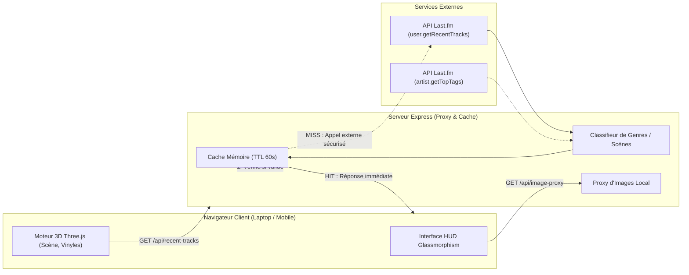

# 🎪 SOUNDLAND 3D — Ce à quoi ressemble ma musique

> Projet WebTech — Visualisation 3D interactive des écoutes musicales récentes Last.fm sous forme d'un festival immersif.

---

## 🌟 Le Concept : L'Archipel Musical / Festival des Genres

Plutôt qu'une simple liste plate d'albums, **Soundland 3D** transforme les dernières écoutes musicales en un festival en 3D composé de différentes scènes thématiques reliées sur une île nocturne.

Chaque morceau écouté récemment est automatiquement analysé, catégorisé selon son genre/style musical, et matérialisé sous la forme d'un **disque vinyle holographique 3D flottant** au-dessus de sa scène dédiée :

* **⚡ The Neon Warehouse (Bunker Rave) :** Pour l'électro, la techno, le hardtek, la trance et le frenchcore (lasers néons, stroboscopes réactifs et mur de son Sound System).
* **🎤 The Urban Party :** Pour le rap, hip-hop, trap et drill (briques, silhouettes de buildings new-yorkais et lampadaire ambré).
* **🌴 One Love Oasis :** Pour le reggae, dub, ska et sonorités acoustiques/chill (plage de sable, palmiers stylisés et feu de camp).
* **🎻 The Crystal Amphitheater :** Pour le classique, l'ambient, les musiques de film et le piano (colonnes de marbre et dôme céleste).
* **🔥 The Volcanic Pit :** Pour le rock, metal, grunge et punk (rochers volcaniques et flammes ardentes).
* **✨ La Place Centrale (Sound Plaza) :** Une place ouverte avec un totem cristallin rotatif reliant les 5 scènes en étoile par des allées illuminées.

Si un morceau est **en cours d'écoute en direct**, il brille d'un halo pulsant et un projecteur le suit automatiquement !

---

## 📋 Respect des Contraintes & Règles du Sujet

| Règle du sujet | Statut | Implémentation |
| :--- | :---: | :--- |
| **Le navigateur parle uniquement à votre serveur** | ✅ | Le front n'appelle jamais `last.fm`. Les données et **les pochettes d'albums** passent par le serveur (`/api/recent-tracks` et `/api/image-proxy`). |
| **La clé API reste sur le serveur dans une variable d'env** | ✅ | Clé stockée dans `.env` (`LASTFM_API_KEY`), absente du code client et ignorée par Git via `.gitignore`. |
| **Le serveur garde les réponses en cache** | ✅ | Cache mémoire avec TTL de 60s. Recharger la page ne sollicite pas l'API Last.fm. |
| **En cas de panne Last.fm, affichage utile** | ✅ | Fallback automatique sur les dernières données en cache + bandeau d'alerte contextuel non intrusif (jamais d'écran blanc). |
| **Fonctionne sur smartphone et laptop** | ✅ | Interface responsive (CSS clamp & flexbox/grid), contrôles tactiles OrbitControls (glisser, pincer pour zoomer). |
| **`docker compose up` démarre tout** | ✅ | Image légère Alpine Node.js prête à l'emploi. |

---

## 🚀 Démarrage Rapide

### Option 1 : Avec Docker (Recommandé pour l'évaluation)

1. Clonez le dépôt :
   ```bash
   git clone https://github.com/<votre-compte>/API_Music.git
   cd API_Music
   ```

2. Créez votre fichier `.env` à partir du template :
   ```bash
   cp .env.example .env
   ```
   *Renseignez-y votre clé `LASTFM_API_KEY` et votre pseudo `LASTFM_USER`.*

3. Lancez le projet en une commande :
   ```bash
   docker compose up --build
   ```

4. Ouvrez votre navigateur sur : **[http://localhost:3000](http://localhost:3000)**

---

### Option 2 : Sans Docker (En local avec Node.js)

**Prérequis :** Node.js 18+ installé.

```bash
# Installation des dépendances
npm install

# Démarrage du serveur
npm start
```

L'application est accessible sur `http://localhost:3000`.

---

## 🏗️ Architecture & Flux de Données



---

## 🎤 Guide pour la Démo de 3 Minutes en Classe

### 1. Présentation (1 minute)
* "Pour répondre au sujet *What your music looks like*, j'ai voulu représenter la diversité de mes écoutes (qui vont de la techno au classique en passant par le rap) sous la forme d'un **Festival 3D immersif**."
* "Chaque scène correspond à une ambiance musicale réelle. Les morceaux récemment scrobbles sur Last.fm sont projetés en 3D sous forme de disques vinyles avec leurs vraies pochettes."
* "Si j'écoute un morceau en direct, la scène s'illumine et le vinyle brille avec la mention *EN DIRECT*."

### 2. Démonstration Technique (1 minute)
* **Preuve du Cache :** Montrer l'inspecteur réseau (F12) $\rightarrow$ Recharger la page : l'indicateur affiche `En cache (45s)` et aucune requête ne part vers Last.fm.
* **Preuve de la Sécurité :** Montrer que l'onglet Réseau ne contient aucune requête sortante vers le domaine Last.fm, et que la clé API n'apparaît nulle part dans le code source du navigateur.
* **Preuve de Résilience (Bouton 'Test Panne') :** Cliquer sur le bouton "Test Panne" dans l'en-tête. L'application intercepte la simulation d'erreur et affiche un message clair tout en conservant l'expérience 3D intacte sans aucun écran blanc.

### 3. Deux Questions Fréquentes du Jury & Réponses Prêtes

* **Q1 : Comment le serveur sait-il sur quelle scène placer un morceau sans BPM ?**
  > *"Last.fm ne fournit pas de BPM dans son flux de tracks récents. Pour contourner cela intelligemment, mon serveur extrait les tags de l'artiste (`artist.getTopTags`), les met en cache, et applique un algorithme de scoring thématique pour orienter automatiquement le morceau vers la scène adéquate (Bunker Techno, Block Rap, Oasis Reggae, etc.)."*

* **Q2 : Pourquoi les images d'albums passent-elles aussi par ton serveur ?**
  > *"La consigne stipule : 'In the browser's Network tab, no request goes to Last.fm'. Si le front chargeait les images directement depuis le CDN de Last.fm, l'inspecteur réseau afficherait des requêtes vers Last.fm. J'ai donc créé un endpoint `/api/image-proxy` avec cache mémoire pour que 100% du trafic web reste strictement entre le navigateur et mon propre serveur."*

---

## 📄 Licence

Projet réalisé dans le cadre du module WebTech — MIT License.
